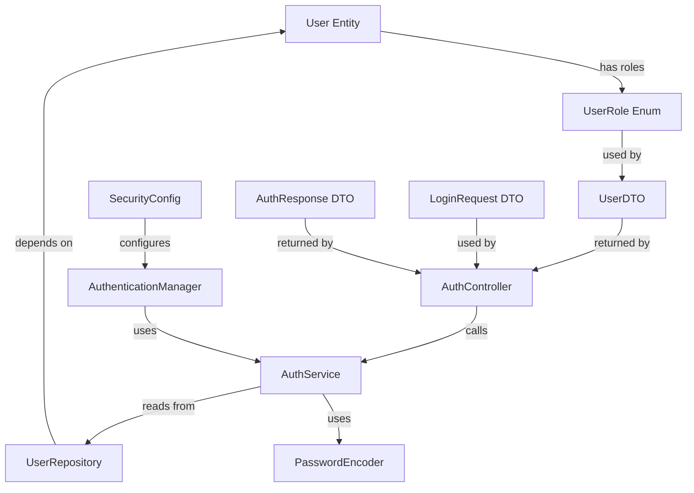

# Spring Security 7 Authentication Implementation Plan

## 📋 Class Creation Order (Dependency-Based)



---

## 🎯 Phase-by-Phase Implementation

### **PHASE 1: Foundation (Day 1)**
*Create these classes FIRST - everything else depends on them*

#### 1.1 `UserRole` Enum ⭐
**Why first?** All other classes reference this enum for roles

```java
// backend/src/main/java/com/expenseanalyzer/auth/UserRole.java
public enum UserRole {
    USER, ADMIN
}
```

**Dependencies:** None  
**Created by:** You (or already exists)

---

#### 1.2 `User` Entity ⭐
**Why second?** Repository needs this entity to work

```java
// backend/src/main/java/com/expenseanalyzer/auth/User.java
@Entity
@Table(name = "users")
public class User {
    @Id
    @GeneratedValue
    private Long id;
    
    @Column(unique = true)
    private String email;
    
    @Column(nullable = false)
    private String password; // BCrypt hashed
    
    @Enumerated(EnumType.STRING)
    private UserRole role;
    
    // getters/setters
}
```

**Dependencies:** `UserRole` enum  
**Created by:** You (or already exists)

---

### **PHASE 2: Data Layer (Day 1)**
*Database access layer - no Spring Security yet*

#### 2.1 `UserRepository` ⭐
**Why third?** AuthService needs to fetch users from database

```java
// backend/src/main/java/com/expenseanalyzer/auth/UserRepository.java
public interface UserRepository extends JpaRepository<User, Long> {
    Optional<User> findByEmail(String email);
}
```

**Dependencies:** `User` entity  
**Created by:** You (or already exists)

---

### **PHASE 3: DTOs (Day 1)**
*Data Transfer Objects - clean input/output from controllers*

#### 3.1 `LoginRequest` ⭐
**Why fourth?** AuthController needs this to receive login data

```java
// backend/src/main/java/com/expenseanalyzer/auth/dto/LoginRequest.java
public class LoginRequest {
    private String email;
    private String password;
    
    // getters/setters + @Valid validation
}
```

**Dependencies:** None  
**Created by:** You (or already exists)

---

#### 3.2 `AuthResponse` ⭐
**Why fifth?** AuthController returns this to client

```java
// backend/src/main/java/com/expenseanalyzer/auth/dto/AuthResponse.java
public class AuthResponse {
    private String token;
    private User user;
    
    // getters/setters
}
```

**Dependencies:** `User` entity  
**Created by:** You (or already exists)

---

### **PHASE 4: Business Logic (Day 2)**
*Core authentication logic - where magic happens*

#### 4.1 `PasswordEncoder` ⭐
**Why sixth?** Needed for password hashing/validation

```java
// backend/src/main/java/com/expenseanalyzer/auth/service/PasswordEncoder.java
@Configuration
public class PasswordEncoder {
    @Bean
    public PasswordEncoder passwordEncoder() {
        return new BCryptPasswordEncoder(12); // high cost factor
    }
}
```

**Dependencies:** Spring Security (auto-configured)  
**Created by:** You (or already exists)

---

#### 4.2 `AuthService` ⭐
**Why seventh?** This is the heart of authentication - validates credentials

```java
// backend/src/main/java/com/expenseanalyzer/auth/service/AuthService.java
@Service
public class AuthService {
    private final UserRepository userRepository;
    private final PasswordEncoder passwordEncoder;
    
    public AuthResponse login(LoginRequest request) {
        // 1. Find user by email
        User user = userRepository.findByEmail(request.getEmail())
            .orElseThrow(() -> new UserNotFoundException("User not found"));
        
        // 2. Validate password
        if (!passwordEncoder.matches(request.getPassword(), user.getPassword())) {
            throw new UnauthorizedException("Invalid credentials");
        }
        
        // 3. Create authentication object
        Authentication auth = new UsernamePasswordAuthenticationToken(
            user, null, user.getRoles()
        );
        
        // 4. Return response
        return new AuthResponse(auth.getName(), user);
    }
}
```

**Dependencies:** `UserRepository`, `PasswordEncoder`, `LoginRequest`  
**Created by:** You (or already exists)

---

### **PHASE 5: Controller Layer (Day 2)**
*REST endpoints - exposes authentication to clients*

#### 5.1 `AuthController` ⭐
**Why eighth?** Entry point for all authentication requests

```java
// backend/src/main/java/com/expenseanalyzer/auth/controller/AuthController.java
@RestController
@RequestMapping("/api/auth")
public class AuthController {
    private final AuthService authService;
    
    @PostMapping("/login")
    public ResponseEntity<AuthResponse> login(@RequestBody LoginRequest request) {
        return ResponseEntity.ok(authService.login(request));
    }
    
    @PostMapping("/register")
    public ResponseEntity<?> register(@RequestBody RegisterRequest request) {
        // Registration logic here
    }
}
```

**Dependencies:** `AuthService`, `LoginRequest`  
**Created by:** You (or already exists)

---

### **PHASE 6: Spring Security Integration (Day 3)**
*Connects everything with Spring Security filter chain*

#### 6.1 `SecurityConfig` ⭐
**Why ninth?** This ties it all together - the final piece

```java
// backend/src/main/java/com/expenseanalyzer/auth/SecurityConfig.java
@Configuration
@EnableWebSecurity
public class SecurityConfig {
    
    @Bean
    public AuthenticationManager authenticationManager() {
        return new InMemoryAuthenticationManager(); // or use Spring's default
    }
    
    @Bean
    public UserDetailsService userDetailsService() {
        return username -> userRepository.findByEmail(username)
            .map(user -> new UserDetails(user))
            .orElseThrow(() -> new UserNotFoundException("User not found"));
    }
    
    @Bean
    public SecurityFilterChain securityFilterChain(HttpSecurity http) throws Exception {
        http
            .csrf(csrf -> csrf.disable()) // or enable with custom config
            .authorizeHttpRequests(auth -> auth
                .requestMatchers("/api/auth/**").permitAll() // allow login/register
                .anyRequest().authenticated() // everything else requires auth
            )
            .formLogin(form -> form.loginPage("/login"))
            .sessionManagement(session -> session.sessionCreationPolicy(SessionCreationPolicy.IF_REQUIRED));
        
        return http.build();
    }
}
```

**Dependencies:** `AuthenticationManager`, `UserDetailsService`, `AuthService`  
**Created by:** You (or already exists)

---

## 📊 Complete Dependency Graph

```
┌─────────────────────────────────────────────────────────────┐
│                    DEPENDENCY ORDER                        │
└─────────────────────────────────────────────────────────────┘

1. UserRole Enum              ← NO DEPENDENCIES
2. User Entity                ← Depends on: UserRole
3. UserRepository             ← Depends on: User
4. LoginRequest DTO           ← NO DEPENDENCIES
5. AuthResponse DTO          ← Depends on: User
6. PasswordEncoder            ← Spring auto-configured
7. AuthService                ← Depends on: UserRepository, PasswordEncoder, LoginRequest
8. AuthController             ← Depends on: AuthService, LoginRequest
9. SecurityConfig             ← Depends on: All above + Spring Security beans
```

---

## ✅ Verification Steps

### After Phase 1 (Foundation):
- [ ] Can you create a `User` entity with `UserRole` enum?
- [ ] Does the entity compile without errors?

### After Phase 2 (Data Layer):
- [ ] Can `UserRepository` find a user by email?
- [ ] Database migration creates `users` table correctly?

### After Phase 3 (DTOs):
- [ ] Can you send `{ "email": "test@test.com", "password": "secret" }` to `/api/auth/login`?
- [ ] DTO validation works with `@Valid`?

### After Phase 4 (Business Logic):
- [ ] Does `AuthService.login()` successfully authenticate a user?
- [ ] Password validation returns correct results?

### After Phase 5 (Controller):
- [ ] Can you POST to `/api/auth/login` from a frontend?
- [ ] Returns `200 OK` with `AuthResponse` on success?
- [ ] Returns `401 Unauthorized` on invalid credentials?

### After Phase 6 (Security Integration):
- [ ] Unauthenticated users are redirected to login page?
- [ ] Authenticated users can access protected endpoints?
- [ ] Role-based authorization works (`hasRole("ADMIN")`)?

---

## 🚀 Quick Start Commands

```bash
# Phase 1: Create User entity and UserRole enum
# backend/src/main/java/com/expenseanalyzer/auth/User.java
# backend/src/main/java/com/expenseanalyzer/auth/UserRole.java

# Phase 2: Create Repository
# backend/src/main/java/com/expenseanalyzer/auth/UserRepository.java

# Phase 3: Create DTOs
# backend/src/main/java/com/expenseanalyzer/auth/dto/LoginRequest.java
# backend/src/main/java/com/expenseanalyzer/auth/dto/AuthResponse.java

# Phase 4: Create Service layer
# backend/src/main/java/com/expenseanalyzer/auth/service/PasswordEncoder.java
# backend/src/main/java/com/expenseanalyzer/auth/service/AuthService.java

# Phase 5: Create Controller
# backend/src/main/java/com/expenseanalyzer/auth/controller/AuthController.java

# Phase 6: Integrate with Spring Security
# backend/src/main/java/com/expenseanalyzer/auth/SecurityConfig.java
```

---

## 🎯 Summary

**Total classes to create:** 9  
**Total time estimate:** 3 days (1 day per phase)  
**Dependencies:** Strict - must follow order above

**Key insight:** Start with data layer (entity + repository), then DTOs, then business logic, finally security integration. This order ensures you can test each piece independently before connecting them all together.
